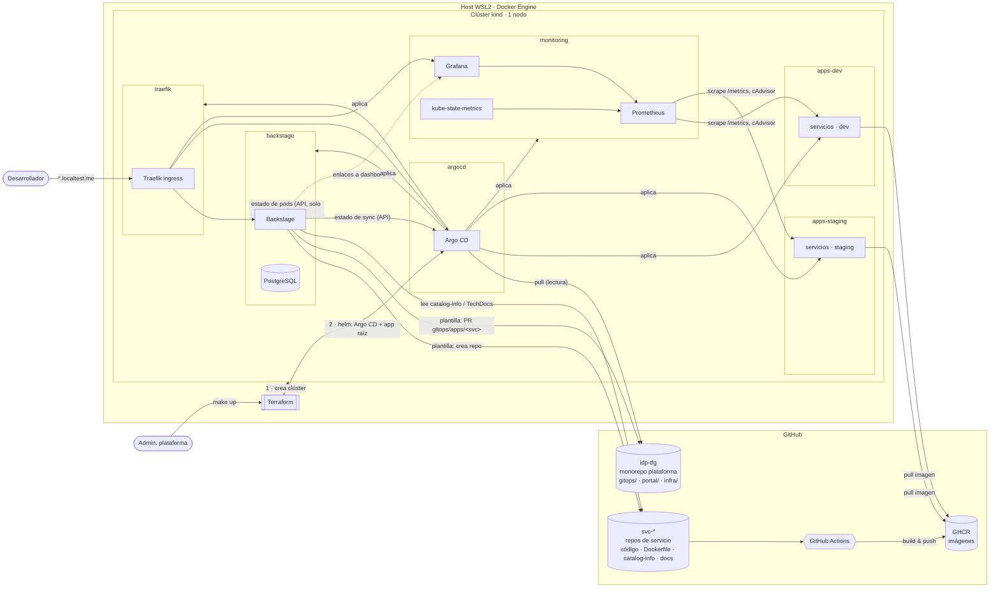
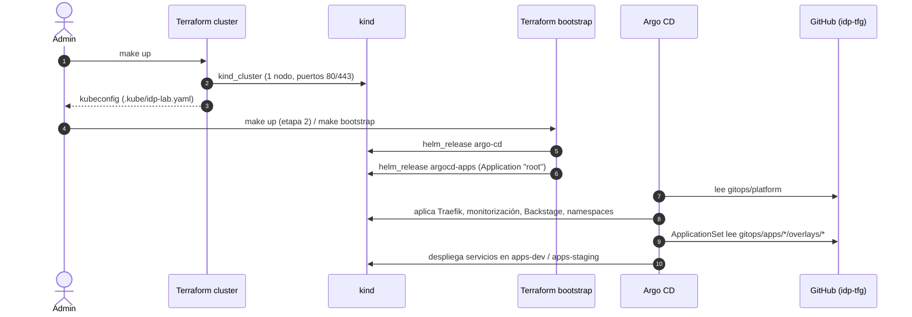
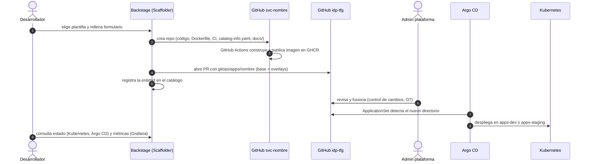

# Arquitectura de la plataforma (v1)

> Estado: **v1 — S3 (12/10/2026)**, actualizada en S4 con el bootstrap implementado. Cubre O1. Las secciones marcadas como *previsto* describen
> diseño aún no implementado; ver `docs/seguimiento.md` para el estado real.

## 1. Visión general

La IDP es una capa de autoservicio sobre herramientas existentes. El desarrollador interactúa con
**Backstage** (y con Git mediante pull requests); el resto de herramientas actúan detrás:

- **Git (GitHub)** es la fuente de verdad del estado deseado y el registro de cambios (RNF-02).
- **Argo CD** reconcilia ese estado sobre **Kubernetes** (kind).
- **Terraform** crea el clúster e instala Argo CD (bootstrap); a partir de ahí no gestiona nada más.
- **Prometheus/Grafana** recogen y presentan métricas; Backstage enlaza a ellas por servicio.



## 2. Componentes y responsabilidades

| Componente | Responsabilidad | Gestionado por | Namespace | Fase |
|---|---|---|---|---|
| Docker Engine (WSL2) | Ejecuta los nodos kind | Script de host (`scripts/host/`) | — | S3 ✔ |
| Clúster kind | Kubernetes del laboratorio | Terraform `infra/terraform/cluster` | — | S3 ✔ |
| Namespaces de entorno | `apps-dev`, `apps-staging` con cuotas y PSA | Argo CD (Application `env-namespaces` → `gitops/platform/namespaces`; kubectl solo en S3) | — | S4 ✔ |
| Argo CD | Reconciliación GitOps | Terraform `infra/terraform/bootstrap` (Helm) | `argocd` | S4 ✔ |
| App raíz (app-of-apps) | Declara el resto de componentes de plataforma | Terraform (chart `argocd-apps`) | `argocd` | S4 ✔ |
| Traefik | Ingress HTTP(S) hacia el portal y herramientas | Argo CD (Application `traefik`) | `traefik` | S4 ✔ |
| kube-prometheus-stack | Prometheus, Grafana, kube-state-metrics, node-exporter | Argo CD | `monitoring` | S10 |
| Backstage + PostgreSQL | Portal, catálogo, plantillas, TechDocs | Argo CD (imagen propia de `portal/`) | `backstage` | S7 |
| Servicios de ejemplo (2) | Cargas de demostración con `/metrics` | Argo CD (ApplicationSet) | `apps-dev`, `apps-staging` | S6 |

## 3. Propiedad de los recursos (Terraform / Helm / Argo CD)

Cada recurso tiene **un único gestor**. Esta es la regla que evita que dos herramientas reconcilien
lo mismo (ADR-0003):

| Capa | Herramienta | Recursos | Estado |
|---|---|---|---|
| 0 · Host | Script `install-docker-wsl.sh` | Docker Engine, systemd, sysctl | Manual documentado (requiere root) |
| 1 · Clúster | Terraform (`cluster`) | `kind_cluster` | `terraform.tfstate` local |
| 2 · Bootstrap | Terraform (`bootstrap`) + provider Helm | Release `argo-cd`, release `argocd-apps` (app raíz y AppProjects) | `terraform.tfstate` local |
| 3 · Plataforma | Argo CD (app-of-apps) | Traefik, monitorización, Backstage, namespaces de entorno | Git (`gitops/platform`) |
| 4 · Servicios | Argo CD (ApplicationSet) | Deployments/Services/Ingress/ServiceMonitor de cada servicio y entorno | Git (`gitops/apps`) |

Argo CD **no** se gestiona a sí mismo: su versión y configuración las define Terraform. Se descarta
el patrón *self-managed* porque Terraform y Argo CD se disputarían el mismo release (ADR-0003).

## 4. Bootstrap sin dependencias circulares



Las dos etapas de Terraform son *root modules* independientes: el provider Helm de la etapa 2 se
configura con un kubeconfig que ya existe, en lugar de depender de atributos desconocidos en tiempo
de plan (problema conocido al configurar providers con salidas de recursos del mismo módulo).

Nada en Git necesita Argo CD para existir, y Argo CD solo necesita leer Git: no hay ciclo.

### Implementación (S4)

| Elemento | Detalle |
|---|---|
| Releases de Terraform | `argocd` (chart `argo-cd`, Argo CD v3.5) y `argocd-apps`; versiones en `versions.env` |
| Argo CD | Una réplica por componente, sin Dex ni notificaciones; `server.insecure` (TLS lo terminaría Traefik); interfaz en `http://argocd.localtest.me` |
| AppProject `platform` | Repositorio de plataforma y charts upstream autorizados; cualquier namespace y recursos de clúster |
| AppProject `services` | Solo `apps-dev`/`apps-staging`; sin recursos de clúster; no puede modificar `ResourceQuota`, `LimitRange` ni `NetworkPolicy` |
| Application `root` | `gitops/platform/apps` en la revisión `LAB_GITOPS_REVISION` (por defecto `main`); `prune` + `selfHeal`; sin finalizador en cascada |
| Applications hijas | `traefik` (chart upstream, `valuesObject` en Git) y `env-namespaces` (Kustomize); los Namespace llevan `Prune=false,Delete=false` para que un cambio en Git no elimine un entorno |

Traefik en kind: `hostPort` 80/443 en el nodo `ingress-ready`, Service `ClusterIP` (kind no tiene
balanceador), estrategia de despliegue que sustituye el pod (dos pods no pueden compartir el
`hostPort`), solo el proveedor estándar de `Ingress` (sin CRDs de Traefik ni Gateway API) y
`ingressEndpoint` 127.0.0.1 para que los `Ingress` tengan estado y Argo CD los considere sanos.

## 5. Estrategia GitOps (ADR-0004)

- **Repositorio de configuración**: `gitops/` en el monorepo de plataforma (público en GitHub,
  Argo CD lo lee sin credenciales).
- **Plataforma**: patrón *app-of-apps*. La app raíz apunta a `gitops/platform/apps/`, donde cada
  componente es un `Application` (chart Helm upstream + `values` versionados).
- **Servicios**: un `ApplicationSet` con *Git directory generator* sobre
  `gitops/apps/*/overlays/*`. Añadir un directorio = nuevo servicio/entorno desplegado, sin editar
  configuración central (O5).
- **Entornos**: overlays de Kustomize `dev` y `staging` sobre una `base` común; cada overlay
  fija namespace, réplicas, recursos y **etiqueta de imagen**.
- **Promoción**: cambio en Git de la etiqueta de imagen del overlay `staging` (PR).
- **Rollback**: `git revert` del commit de promoción; Argo CD reconcilia al estado anterior.
- **Sincronización**: automática con `prune` y `selfHeal` en ambos entornos; la deriva manual en el
  clúster se revierte, lo que refuerza Git como fuente de verdad.
- **AppProjects**: `platform` (componentes de plataforma, solo admins) y `services` (limitado a los
  namespaces `apps-*` y a recursos namespaced), como frontera de permisos (O7).

### Estructura prevista de `gitops/`

```text
gitops/
├── platform/
│   ├── namespaces/              # S3 ✔  apps-dev, apps-staging (+ LimitRange, ResourceQuota)
│   └── apps/                    # S4 ✔  Applications de plataforma: traefik, env-namespaces
└── apps/                        # S6    un directorio por servicio
    └── <servicio>/
        ├── base/                # Deployment, Service, Ingress, ServiceMonitor
        └── overlays/{dev,staging}/
```

## 6. Separación de entornos

Un único clúster con dos entornos lógicos, tal como acota la PEC1:

| Aspecto | dev | staging |
|---|---|---|
| Namespace | `apps-dev` | `apps-staging` |
| Overlay Kustomize | `overlays/dev` | `overlays/staging` |
| Hostname (previsto) | `<svc>.dev.localtest.me` | `<svc>.staging.localtest.me` |
| Cuota | 2 CPU req · 2 GiB req · 3 GiB lím. | ídem |
| Pod Security Admission | `baseline` (aviso `restricted`) | ídem |

Limitación asumida: no hay aislamiento de nodo ni de red entre entornos (no se despliegan
NetworkPolicies en S3); se documenta en `docs/seguridad.md`.

## 7. Flujo de alta de un servicio (O5, previsto S9)



La revisión del PR por un administrador es deliberada: separa perfiles (desarrollador propone,
plataforma aprueba) sin automatizaciones adicionales, y deja trazabilidad en Git.

## 8. Portal (previsto S7–S9)

- App Backstage generada con `@backstage/create-app` en `portal/`, con el nuevo *backend system*.
- Personalización mediante tema propio y páginas/entidades del catálogo; no se reimplementa el
  portal (requisito del prompt maestro).
- Plugins previstos: Software Catalog, Scaffolder, TechDocs (*local builder*), Kubernetes
  (estado de pods, ServiceAccount de solo lectura), integración con Argo CD (estado de sync) y
  enlaces/paneles de Grafana por anotación.
- Autenticación y permisos: proveedor de identidad y *permission policy* en backend con dos
  grupos, `platform-admins` y `developers` (O7). Decisión concreta en ADR pendiente (S7).

## 9. Observabilidad (previsto S10)

| Indicador (O6) | Fuente | Métrica base |
|---|---|---|
| Estado de pods | kube-state-metrics | `kube_pod_status_phase`, `kube_pod_container_status_restarts_total` |
| CPU | cAdvisor (kubelet) | `container_cpu_usage_seconds_total` |
| Memoria | cAdvisor (kubelet) | `container_memory_working_set_bytes` |
| Peticiones / disponibilidad | `/metrics` del servicio (ServiceMonitor) | `http_requests_total`, `up` |

kube-prometheus-stack con Alertmanager desactivado y retención corta. Un dashboard de Grafana
versionado (ConfigMap con *sidecar*) parametrizado por `namespace` y `service`; Backstage enlaza
a él con las variables del servicio seleccionado.

## 10. Estimación de recursos

Estimación de diseño; se contrasta con medidas reales al completar cada fase. Medida S4
(12/10/2026, `docker stats` del nodo): clúster + Argo CD + Traefik = **1,41 GiB**, dentro del rango
estimado para esos bloques (1,1 – 1,6 GiB).

| Bloque | Memoria estimada |
|---|---|
| Nodo kind (control plane, CoreDNS, kube-proxy) | 0,6 – 0,9 GiB |
| Argo CD (sin Dex ni notificaciones, 1 réplica) | 0,4 – 0,6 GiB |
| Traefik | 0,1 GiB |
| kube-prometheus-stack reducido | 0,8 – 1,2 GiB |
| Backstage + PostgreSQL | 0,6 – 1,0 GiB |
| 2 servicios × 2 entornos | 0,1 – 0,3 GiB |
| **Total clúster** | **≈ 2,6 – 4,1 GiB** |

Con 10 GiB asignados a WSL queda margen para Docker y para compilar el portal. El objetivo de 8 GB
de la PEC1 se respeta permitiendo levantar fases parciales (sin monitorización o sin portal).

## 11. Riesgos y dependencias

| ID | Riesgo | Impacto | Mitigación |
|---|---|---|---|
| R1 | Memoria insuficiente con el stack completo | Alto | Nodo único, componentes reducidos, `.wslconfig` a 10 GB, fases parciales |
| R2 | Provider `tehcyx/kind` comunitario y con ritmo de publicación lento | Medio | Versión fijada; Kubernetes alineado con su librería (1.35); alternativa: `kind create cluster --config` desde script |
| R3 | Dependencia de GitHub (repos, GHCR, Actions) | Medio | Repos públicos y planes gratuitos; el clúster solo necesita lectura anónima |
| R4 | Compilación de Backstage costosa en memoria/tiempo | Medio | Construir la imagen en GitHub Actions; fijar versión de Backstage |
| R5 | Compatibilidad de plugins comunitarios (Argo CD) con el nuevo backend de Backstage | Medio | Verificar en S8; alternativa: enlaces + estado vía plugin Kubernetes |
| R6 | ingress-nginx retirado por la comunidad Kubernetes (2026) | Bajo | Se usa Traefik (ADR-0005) |
| R7 | Red de WSL2 (acceso desde el navegador de Windows a `localhost`) | Bajo | Puertos publicados en 127.0.0.1; reenvío de localhost de WSL; documentado en instalación |
| R8 | Imágenes Bitnami ya no gratuitas en su catálogo público | Bajo | PostgreSQL con imagen oficial `postgres` |

Dependencias entre fases: S4 (Argo CD) requiere el repo publicado en GitHub; S7 (portal) requiere
S4 para su despliegue; S9 (plantilla) requiere S6 (estructura de `gitops/apps`) y S7; S10 requiere
que los servicios expongan `/metrics` (S6).
